<!-- MATRIX GREEN | VAMSI KRISHNA -->

<div align="center">


<br/>


</div>

---

<!-- MATRIX DIGITAL RAIN NAME -->

<div align="center">



</div>

<!-- ANIMATED DEVELOPER TERMINAL -->

## 💻 Developer Terminal

<div align="center">



</div>

### ⚡ Execute Commands

<div align="center">

<a href="https://github.com/vamsikrishna1332-creator?tab=repositories">

</a>

<a href="https://github.com/vamsikrishna1332-creator">

</a>

</div>

---

## 🧑‍💻 About Me

```python
class Developer:
    def __init__(self):
        self.name = "Vamsi Krishna"
        self.username = "vamsikrishna1332-creator"
        self.languages = ["Python", "C++"]
        self.interests = [
            "Software Development",
            "Linux",
            "Operating Systems",
            "Automation",
            "Artificial Intelligence"
        ]
        self.current_status = "Learning and Building"

    def motto(self):
        return "Code. Create. Innovate. Repeat."

me = Developer()
```

- 🔭 Exploring software and systems development
- 🌱 Learning Python, C++ and web technologies
- 🐧 Interested in Linux and open-source software
- 🤖 Experimenting with AI and automation
- ⚙️ Curious about operating systems and tools

---

## 🛠️ Technology Stack

<div align="center">

### Languages


### Tools & Platforms


</div>

---

## 📊 GitHub Analytics

<div align="center">


</div>

---

## 🐍 Contribution Snake

<div align="center">


</div>

---

## 🚀 Project Explorer

<div align="center">

<a href="https://github.com/vamsikrishna1332-creator?tab=repositories">

</a>

</div>

| Area | Exploration |
|:---|:---|
| 🐍 Python | Programming and automation |
| ⚙️ Systems | Operating systems and utilities |
| 🐧 Linux | Open-source technologies |
| 🤖 AI | Intelligent applications |
| 🌐 Web | Web development |

---

## 🟢 System Status

<div align="center">


</div>

```text
> INITIALIZATION COMPLETE
> DEVELOPER MODE: ENABLED
> CREATIVITY ENGINE: ONLINE
> NEXT OBJECTIVE: BUILD SOMETHING GREAT
```

---

<div align="center">

### 💚 "The best way to learn is to build."

**CODE • CREATE • INNOVATE • REPEAT**


</div>
